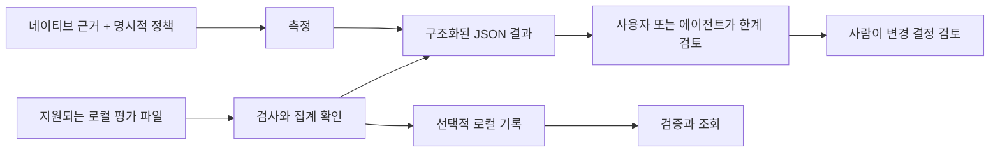

<div align="center">

<h1></h1>

### 평가 파일을 에이전트가 활용할 근거로.

결과를 살펴보고, 근거를 보관하고, 빠진 정보를 드러냅니다.

**로컬 CLI와 Python 라이브러리 · 구조화된 JSON · 서버나 모델 호출 없이**

[](https://github.com/ntts9990/underwrite/actions/workflows/ci.yml)
[](https://pypi.org/project/underwrite/)
[](https://pypi.org/project/underwrite/)
[](LICENSE)

**[직접 실행하기](#빠른-시작)** · [에이전트와 사용하기](#에이전트-사용) · [지원 형식](#지원-형식) · [문서](#문서)

[English](README.md) · **한국어**

</div>

underwrite는 지원되는 로컬 평가 내보내기 파일을 사람과 코딩 에이전트가 살펴보고,
저장하고, 다시 사용할 수 있는 구조화된 결과로 바꿉니다. **goppi, Langfuse,
DeepEval, Promptfoo**의 결과를 가져와 해당 아티팩트에 맞는 경로로 처리하면,
무엇이 제공되었고 무엇이 아직 알려지지 않았는지 확인할 수 있습니다.

터미널과 에이전트 작업 흐름에서 기존 파일을 읽고 JSON을 받은 뒤, 호출한 에이전트가
설명을 작성하도록 하세요. 파일을 검사하는 데 Docker, 대시보드, 제공자 인증 정보나
평가 재실행은 필요하지 않습니다.

> [!NOTE]
> **이 README는 개발 체크아웃을 설명합니다.** 아래 작업 흐름은 PyPI에 공개된
> `0.0.1`보다 이후에 추가되었습니다. 직접 사용하려면 소스 빠른 시작을 따르세요.
> 두 빌드는 여전히 같은 버전 번호를 사용합니다. [공개판 설치](#설치).

## 빠른 시작

**Python 3.12 이상**과 [uv](https://docs.astral.sh/uv/)가 필요합니다.
포함된 합성 예제를 실행해 보세요. API 키나 인접한 다른 저장소는 필요하지 않습니다.

```sh
git clone https://github.com/ntts9990/underwrite.git
cd underwrite
uv sync --frozen --all-groups

uv run --frozen --no-sync underwrite audit-promptfoo \
  fixtures/examples/evidence/synthetic-promptfoo-count-mismatch.json --json
```

원본 요약은 **결과 3개**를 선언하지만, 파일에는 **행 2개**가 있습니다.
명령은 이 불일치를 보고합니다. 다음은 다른 필드를 생략한 실제 출력입니다.

```json
{
  "schema": "promptfoo_accounting.v1",
  "declared_relation": "inconsistent",
  "producer_stats": {"errors": 1, "failures": 1, "successes": 1, "total": 3},
  "row_tallies": {"errors": 1, "failures": 0, "successes": 1, "total": 2},
  "limitations": [
    "PLANNED_DENOMINATOR_UNKNOWN",
    "CAUSE_UNKNOWN",
    "SOURCE_CLAIMS_UNVERIFIED",
    "NO_APPROVAL_AUTHORITY"
  ]
}
```

행이 없는 이유를 추측하거나 원천의 판정을 독립적으로 검증된 사실로 취급하지 않고도
구체적인 불일치를 확인할 수 있습니다. 종료 코드 `0`은 보고서가 생성되었다는 뜻입니다.
결과를 해석하려면 보고서의 필드를 확인하세요. 입력과 분석을 함께 보관하려면
[로컬 기록으로 저장하세요](#다시-찾아볼-수-있는-결과-보관).

<details>
<summary><strong>네이티브 측정 → 수락 분류 흐름 실행하기</strong></summary>

같은 체크아웃에서 포함된 합성 이진 사건 예제를 실행합니다.

```sh
mkdir -p output
uv run --frozen --no-sync underwrite ingest \
  --format underwrite.evidence-bundle --version v1 \
  --file fixtures/examples/event-measurement/bundle.json --json \
  > output/observation.json

uv run --frozen --no-sync underwrite measure \
  --observation output/observation.json \
  --policy fixtures/examples/event-acceptance/policy.json --json \
  > output/read-event.json

uv run --frozen --no-sync underwrite accept \
  --candidate fixtures/examples/event-acceptance/candidate-single.json \
  --claims fixtures/examples/event-acceptance/claims.json \
  --read output/read-event.json --json
```

이 예제는 합성 이진 사건의 비율을 측정하며, 일반 품질이나 지연 시간을 측정하지 않습니다.
`read.v2`는 명시적인 `measurement_policy.v3`을 사용하고, 보정 진단값은 판정에
투표하지 않습니다. 최종 분류는 `screened`이며, 사람의 검토가 필요하고
`merge_authorized`는 false로 유지됩니다. 필요한 주장마다 `--read`를 반복해 전달하세요.
[측정의 의미](AGENT_USAGE.md#measurement-meaning-and-migration)를 참고하세요.

</details>

## 왜 underwrite인가요?

- **요약 뒤에 숨은 불일치를 찾습니다.** Promptfoo의 선언 집계와 실제 제공된 행을
  비교하고, 전용 집계 검사 명령으로 DeepEval의 평가기 오류와 Langfuse 점수의
  연결 관계를 확인합니다.
- **에이전트가 바로 활용할 결과를 제공합니다.** 타입이 명시된 JSON에 입력 식별 정보,
  발견 사항, 해석의 한계를 담습니다. `capabilities --json`은 현재 실행 파일의
  명령과 입력 프로필을 알려줍니다.
- **답변의 근거가 된 바이트를 보관합니다.** 선택한 입력과 분석을 불변 로컬 기록으로
  저장합니다. 원래 경로 없이도 나중에 검증하고 조회하며, 저장된 네이티브 측정은
  현재 엔진으로 다시 계산할 수 있습니다.
- **측정 기준을 명시합니다.** 제공된 정책에 따라 네이티브 이진 사건 근거를 측정합니다.
  누락된 근거나 선언되지 않은 가정을 성공 판정으로 바꾸지 않고 결과에 드러냅니다.

## 작동 방식



이 검토 단계는 살펴볼 근거를 제공합니다. 제안된 변경을 적용하거나 병합 권한을
부여하지 않습니다. 로컬 기록은 선택한 입력과 결과를 나중에 검토할 수 있도록 보관합니다.

## 에이전트 사용

코딩 에이전트에 준비된 체크아웃과 내보낸 아티팩트를 제공하세요. 에이전트는 사용 가능한
경로를 찾고 실행한 뒤 JSON을 답변에 활용할 수 있습니다.

```sh
uv run --frozen --no-sync underwrite --help
uv run --frozen --no-sync underwrite capabilities --json
```

터미널을 사용할 수 있는 에이전트에게 다음과 같이 요청할 수 있습니다.

> 이 체크아웃의 `skills/underwrite-review/SKILL.md`를 읽으세요.
> `fixtures/examples/evidence/synthetic-promptfoo-count-mismatch.json`을
> Promptfoo 0.123.0 내보내기 파일로 검토하세요. `capabilities --json`과
> `audit-promptfoo`를 사용하세요. `declared_relation`, `producer_stats`,
> `row_tallies`, `raw_hash`, `limitations`와 다음으로 할 만한 작업을 보고하세요.
> 생성 도구를 다시 실행하거나 종료 코드 `0`을 일치 또는 승인으로 해석하지 마세요.

선택 설치형 [underwrite-review 스킬](skills/underwrite-review/SKILL.md)은 Codex와
Claude Code에서 재사용할 수 있는 지침을 제공합니다.
[설정과 사용 안내](AGENT_USAGE.md#optional-artifact-review-skill)에 따라 사용하며,
스킬이 CLI를 설치하거나 백그라운드 서비스를 추가하지는 않습니다.
직접 만든 자동화에서도 같은 CLI와 가져와 사용할 수 있는 Python API를 이용할 수 있습니다.

## 지원 형식

지원 범위는 **아래의 구체적인 로컬 페이로드 프로필**입니다. 각 도구가 제공하는 모든
API, 내보내기 형식, 버전을 지원한다는 뜻은 아닙니다. 버전을 명시적으로 선택하세요.

| 입력 | 지원 프로필 | 시작 경로 |
| --- | --- | --- |
| **goppi** | 완료된 baseline exchange manifest v2; paired handoff는 별도 경로 | [`project-baseline`](AGENT_USAGE.md#project-a-completed-goppi-baseline-into-event-observations) · [`review-handoff`](AGENT_USAGE.md#review-a-completed-paired-handoff-in-one-call) |
| **Langfuse** | `4.35.0` 서버 blob export: observations-v2와 scores JSON 배열 | [`audit-langfuse`](AGENT_USAGE.md#account-for-langfuse-score-kinds-and-associations) |
| **DeepEval** | 일반 TestRun JSON, `4.1.1` 또는 `4.2.8` | [`audit-deepeval`](AGENT_USAGE.md#account-for-deepeval-scores-and-evaluator-errors) |
| **Promptfoo** | Eval output JSON, `0.123.0` 또는 `0.124.1` | [`audit-promptfoo`](AGENT_USAGE.md#source-checkout-pilot-audit-promptfoo-counts) |
| **네이티브 근거** | `underwrite.evidence-bundle` / `v1` | `ingest` → `measure` → `accept` |
| **Inspect AI** | `inspect.eval-log` / `0.3.263` | `ingest` |
| **OpenInference** | `openinference.traces` / `0.1.38` | `ingest` |
| **OTLP JSON** | `otlp-json.traces` / `0.160.0` | `ingest` |

DeepEval 집계 검사의 기본값은 `4.1.1`입니다. `4.2.8` 프로필을 쓰려면
`--version 4.2.8`을 지정하세요. Promptfoo 집계 검사의 기본값은 `0.123.0`이며,
`0.124.1` 프로필에는 `--version 0.124.1`을 지정합니다. Langfuse의 버전은 SDK가 아니라
서버 내보내기를 가리킵니다. 검사한 범위와 fixture의 출처는
[아티팩트 요구사항](AGENT_USAGE.md#get-the-right-producer-artifact)과
[생성 도구 검증](EVIDENCE_REVIEW.md)을 참고하세요.

범용 `ingest` / `project`는 지원되는 내보내기를 관측으로 정규화합니다.
외부 관측은 현재 `measure` 경로로 이어지지 않습니다. goppi는 명시적인 exchange
어댑터를 사용합니다. `project-baseline`은 네이티브 사건 관측을 만들 수 있고,
`prepare-event-policy`는 소비자 설정을 결합하면서 통계 가정은 알 수 없는 상태로 둡니다.

## 다시 찾아볼 수 있는 결과 보관

분석과 선택한 원본 바이트를 함께 보관하려면 `records`를 사용하세요.
예를 들어 소스 빠른 시작을 실행한 뒤 다음 명령을 사용할 수 있습니다.

```sh
mkdir -p output
uv run --frozen --no-sync underwrite records audit-promptfoo \
  fixtures/examples/evidence/synthetic-promptfoo-count-mismatch.json \
  --root output/review-store --id demo-001 --json

uv run --frozen --no-sync underwrite records read-json \
  --root output/review-store --id demo-001 \
  --name analysis/accounting.json --json
```

캡처할 때마다 새 ID를 사용하세요. 기존 기록은 덮어쓰지 않습니다.
`records verify`는 저장된 데이터의 무결성을 검사합니다. `records measure`는
네이티브 측정을 캡처하고, `records replay-measure`는 검증된 저장 입력을 현재 엔진으로
다시 계산합니다. 원래 생성 도구를 실행하지 않습니다.

기록에는 비공개 내용이 담길 수 있는 원본 입력이 보관됩니다. 비공개 로컬 POSIX
파일시스템과 백업 전략을 선택하세요. Git에서 제외된 이 체크아웃의 `output/`은
시연용 위치이며 백업이 아닙니다. [저장 계약과 복구](STORAGE.md)를 참고하세요.

## 결과가 의미하는 것

underwrite는 서로 다른 종류의 근거를 구분합니다.

| 결과 | 확인할 수 있는 것 |
| --- | --- |
| 원천 집계 검사 | 제공된 행, 점수, 선언 요약 사이의 관계 |
| 바이트 해시와 기록 검증 | 선택한 바이트의 동일성과 무결성. 독립적인 출처 증명은 아님 |
| 네이티브 측정 | 제공된 사건 정의, 모집단, 통계 가정 아래의 결과 |
| 수락 분류 | 선언된 주장과 read에 따른 정책 결과. 병합이나 배포 권한은 없음 |

`not_measured`, `indeterminate`, `abstained`는 서로 다른 상태로 유지됩니다.
빠진 정보는 명시적으로 드러납니다. 원천 점수가 자동으로 보정된 확률이 되는 것은 아니며,
명령 실행에 성공했다고 배포가 승인되는 것도 아닙니다.

## 설치

이 페이지의 작업 흐름을 사용하려면 [소스 빠른 시작](#빠른-시작)을 따르세요.
`uv sync`는 같은 워크스페이스의 `underwrite-core`를 선택합니다. 개발 wheel도
같은 체크아웃에서 빌드한 앱과 코어를 함께 사용해야 합니다.

<details>
<summary>이전 PyPI 공개판 0.0.1 설치</summary>

```sh
uv tool install 'underwrite==0.0.1'
underwrite --help
```

공개된 [앱](https://pypi.org/project/underwrite/0.0.1/)과
[코어](https://pypi.org/project/underwrite-core/0.0.1/)는 다시 릴리스되지 않았습니다.
이 배포물에는 개발판의 측정, 집계 검사, 기록, handoff, `capabilities` 작업 흐름이
포함되어 있지 않습니다. 설치된 명령은 `--help`로 확인하세요. 버전 번호가 같다고
기능도 같은 것은 아닙니다. 개발판 앱 wheel과 공개판 코어를 섞지 마세요.

</details>

## CLI

각 옵션은 `underwrite <command> --help`로 확인하세요. 위 작업 흐름 외에도
`inspect`는 아티팩트 매니페스트를 검사하고, `audit-counts`는 기대 해시가 담긴
매니페스트를 기준으로 Promptfoo 집계를 검사합니다. `check`는 릴리스 근거의 연결을,
`absence`는 모집단의 존재 여부를, `boundary scan`은 설정된 판정 어휘를 검사합니다.
`drift check` / `pins refresh`는 제공된 핀 등록부를 다룹니다.
각 명령 계열의 결과와 오류는 [JSON 계약](contracts/)에 정의되어 있습니다.

<a id="개발-체크아웃의-근거-검사-파일럿"></a>

## 문서

| 알아볼 내용 | 안내 |
| --- | --- |
| 에이전트 실행, 입력 선택, JSON 해석 | [에이전트 사용](AGENT_USAGE.md) |
| 선언, 쌍대 근거, goppi handoff 비교 | [근거 작업 흐름](AGENT_USAGE.md#source-checkout-pilot-compare-declarations) |
| 저장, 검증, 조회, 재계산 | [로컬 기록](STORAGE.md) |
| 생성 도구 fixture와 검증 범위 | [생성 도구 근거](EVIDENCE_REVIEW.md) |
| CLI와 순수 계산 코어 확장 | [기여 안내](CONTRIBUTING.md) · [아키텍처 규칙](AGENTS.md) |

## 기여

재현 가능한 아티팩트, 구체적인 작업 흐름, 수정안을 제안해 주세요.
[이슈](https://github.com/ntts9990/underwrite/issues)에 생성 도구의 버전과 기대하는
결과를 적고, 예제는 민감한 정보를 제거한 것만 공유하세요. 로컬 preflight와 PR 검사는
[CONTRIBUTING.md](CONTRIBUTING.md), 비공개 취약점 신고는
[SECURITY.md](SECURITY.md)를 참고하세요.

<details>
<summary>유지관리자 안내: 향후 PyPI 릴리스</summary>

OIDC 배포를 사용하기 전에 GitHub 환경 `pypi`를 만들고 `main`으로 제한합니다.
**각** PyPI 패키지에 GitHub Trusted Publisher를 설정합니다. 소유자는 `ntts9990`,
저장소는 `underwrite`, 워크플로는 `publish.yml`, 환경은 `pypi`입니다.
설정 후 GitHub Actions에서 `main`의 **Publish PyPI**를 수동 실행합니다.

워크플로는 두 패키지를 검증한 뒤 코어, 애플리케이션 순서로 배포합니다. 별도 배포
작업에만 OIDC 권한이 부여되며, 저장된 PyPI API 토큰은 필요하지 않습니다. 일부만
업로드됐다면 동일한 아티팩트로 재시도합니다. 이미 등록된 파일은 정확히 일치해야 하며,
아티팩트가 바뀌면 새 버전이 필요합니다.

공식 [uv 배포 가이드](https://docs.astral.sh/uv/guides/package/)와
[PyPI Trusted Publisher 가이드](https://docs.pypi.org/trusted-publishers/using-a-publisher/)를 참고하세요.

</details>

## 라이선스

[Apache-2.0](LICENSE). 적용한 정책 템플릿의 CC 라이선스는
[LICENSING.md](LICENSING.md)에 기록되어 있습니다.
