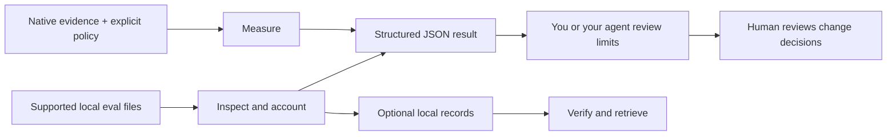

<div align="center">

<h1></h1>

### From eval files to evidence your agent can use.

Inspect results. Keep the evidence. Make missing information visible.

**Local CLI & Python library · Structured JSON · No server or model calls**

[](https://github.com/ntts9990/underwrite/actions/workflows/ci.yml)
[](https://pypi.org/project/underwrite/)
[](https://pypi.org/project/underwrite/)
[](LICENSE)

**[Try it](#quickstart)** · [Use with an agent](#agent-use) · [Supported formats](#supported-formats) · [Docs](#documentation)

**English** · [한국어](README.ko.md)

</div>

underwrite turns supported local evaluation exports into structured results you
and your coding agent can inspect, save, and reuse. Bring results from **goppi,
Langfuse, DeepEval, or Promptfoo**; use the route for that artifact to check what
was supplied and what remains unknown.

It fits into your terminal and agent workflow. Read existing files, get JSON,
and let the calling agent write the explanation. No Docker, dashboard, provider
credentials, or evaluation rerun is needed to inspect those files.

> [!NOTE]
> **This README describes the development checkout.** The workflows below are
> newer than the published PyPI `0.0.1`. Use the source quickstart to try them;
> both builds still have the same version number. [Published installation](#install).

## Quickstart

Requires **Python 3.12+** and [uv](https://docs.astral.sh/uv/).
Run a bundled synthetic example—no API key or adjacent repository required:

```sh
git clone https://github.com/ntts9990/underwrite.git
cd underwrite
uv sync --frozen --all-groups

uv run --frozen --no-sync underwrite audit-promptfoo \
  fixtures/examples/evidence/synthetic-promptfoo-count-mismatch.json --json
```

The source summary declares **3 results**; the file contains **2 rows**.
The command reports the inconsistency. Actual output, with other fields omitted:

```json
{
  "schema": "promptfoo_accounting.v1",
  "declared_relation": "inconsistent",
  "producer_stats": {"errors": 1, "failures": 1, "successes": 1, "total": 3},
  "row_tallies": {"errors": 1, "failures": 0, "successes": 1, "total": 2},
  "limitations": [
    "PLANNED_DENOMINATOR_UNKNOWN",
    "CAUSE_UNKNOWN",
    "SOURCE_CLAIMS_UNVERIFIED",
    "NO_APPROVAL_AUTHORITY"
  ]
}
```

You get a concrete finding without guessing why a row is absent or treating the
source's verdict as independently verified. Exit `0` means the report was
produced; inspect its fields to interpret the result. To keep the input and
analysis together, [save them in a local record](#keep-results-you-can-return-to).

<details>
<summary><strong>Try the native measurement → acceptance workflow</strong></summary>

From the same checkout, run the included synthetic binary-event example:

```sh
mkdir -p output
uv run --frozen --no-sync underwrite ingest \
  --format underwrite.evidence-bundle --version v1 \
  --file fixtures/examples/event-measurement/bundle.json --json \
  > output/observation.json

uv run --frozen --no-sync underwrite measure \
  --observation output/observation.json \
  --policy fixtures/examples/event-acceptance/policy.json --json \
  > output/read-event.json

uv run --frozen --no-sync underwrite accept \
  --candidate fixtures/examples/event-acceptance/candidate-single.json \
  --claims fixtures/examples/event-acceptance/claims.json \
  --read output/read-event.json --json
```

This measures a synthetic binary-event proportion, not general quality or latency.
The `read.v2` uses an explicit `measurement_policy.v3`; calibration diagnostics do
not vote on its verdict. The final classification is `screened`, requires human
review, and keeps `merge_authorized` false. Repeat `--read` for each required claim.
See [measurement meaning](AGENT_USAGE.md#measurement-meaning-and-migration).

</details>

## Why underwrite?

- **Catch the mismatch behind the summary.** Compare Promptfoo's declared counts
  with its supplied rows; inspect DeepEval evaluator errors and Langfuse score
  associations through dedicated accounting commands.
- **Give your agent a usable result.** Typed JSON includes input identities,
  findings, and interpretation limits. `capabilities --json` describes the
  commands and input profiles of the executable in use.
- **Keep the bytes behind the answer.** Capture selected inputs and their analysis
  in immutable local records. Verify and retrieve them later without the original
  paths; recalculate saved native measurements with the current engine.
- **Make the measurement explicit.** Measure native binary-event evidence under
  a supplied policy. Missing evidence and undeclared assumptions remain visible
  instead of becoming a successful verdict.

## How it works



These review steps produce evidence for inspection. They do not apply a proposed
change or grant merge authority. Local records keep selected inputs and results
for later review.

## Agent use

Give your coding agent the prepared checkout and an exported artifact. It can
discover the available routes, execute them, and use the JSON in its response:

```sh
uv run --frozen --no-sync underwrite --help
uv run --frozen --no-sync underwrite capabilities --json
```

Example task for an agent with terminal access:

> Read `skills/underwrite-review/SKILL.md` in this checkout. Review
> `fixtures/examples/evidence/synthetic-promptfoo-count-mismatch.json` as a
> Promptfoo 0.123.0 export. Use `capabilities --json` and `audit-promptfoo`.
> Report `declared_relation`, `producer_stats`, `row_tallies`, `raw_hash`,
> `limitations`, and the next useful action. Do not rerun the producer or treat
> exit `0` as agreement or approval.

The optional [underwrite-review skill](skills/underwrite-review/SKILL.md) provides
reusable guidance for Codex and Claude Code. [Setup and usage](AGENT_USAGE.md#optional-artifact-review-skill)
are explicit: the skill does not install the CLI or add a background service.
The same CLI and importable Python APIs are available to your own automation.

## Supported formats

Support is for the **specific local payload profiles below**, not every API,
export, or version offered by each producer. Select the version explicitly.

| Your input | Supported profile | Start here |
| --- | --- | --- |
| **goppi** | Completed baseline exchange manifest v2; separate paired-handoff route | [`audit-baseline`](AGENT_USAGE.md#audit-a-completed-goppi-baseline-as-common-evidence) for descriptive common JSON · [`project-baseline`](AGENT_USAGE.md#project-a-completed-goppi-baseline-into-event-observations) for native measurement · [`review-handoff`](AGENT_USAGE.md#review-a-completed-paired-handoff-in-one-call) |
| **Langfuse** | `4.35.0` server blob exports: observations-v2 and scores JSON arrays | [`audit-langfuse`](AGENT_USAGE.md#account-for-langfuse-score-kinds-and-associations) |
| **DeepEval** | Ordinary TestRun JSON, `4.1.1` or `4.2.8` | [`audit-deepeval`](AGENT_USAGE.md#account-for-deepeval-scores-and-evaluator-errors) |
| **Promptfoo** | Eval output JSON, `0.123.0` or `0.124.1` | [`audit-promptfoo`](AGENT_USAGE.md#source-checkout-pilot-audit-promptfoo-counts) |
| **Native evidence** | `underwrite.evidence-bundle` / `v1` | `ingest` → `measure` → `accept` |
| **Inspect AI** | `inspect.eval-log` / `0.3.263` | `ingest` |
| **OpenInference** | `openinference.traces` / `0.1.38` | `ingest` |
| **OTLP JSON** | `otlp-json.traces` / `0.160.0` | `ingest` |

DeepEval accounting defaults to `4.1.1`; select `--version 4.2.8` for that
profile. Promptfoo accounting defaults to `0.123.0`; select `--version 0.124.1`
for that profile. Langfuse's version identifies the server export, not its SDK.
See [artifact requirements](AGENT_USAGE.md#get-the-right-producer-artifact) and
[producer checks](EVIDENCE_REVIEW.md) for the tested scope and fixture origins.

Generic `ingest` / `project` normalizes supported exports to an observation;
external observations do not enter the current `measure` path. goppi uses its
explicit exchange adapters: `audit-baseline` produces descriptive
`evidence_result.v1` without a policy or directional verdict, while
`project-baseline` can produce native event observations. `prepare-event-policy`
binds a consumer configuration while leaving statistical assumptions unknown.

## Keep results you can return to

Use `records` when you want the analysis and its selected source bytes retained
together. For example, after the source quickstart:

```sh
mkdir -p output
uv run --frozen --no-sync underwrite records audit-promptfoo \
  fixtures/examples/evidence/synthetic-promptfoo-count-mismatch.json \
  --root output/review-store --id demo-001 --json

uv run --frozen --no-sync underwrite records read-json \
  --root output/review-store --id demo-001 \
  --name analysis/accounting.json --json
```

Use a fresh ID for each capture; existing records are never overwritten.
`records verify` checks stored integrity. `records measure` captures a native
measurement, and `records replay-measure` recalculates it from verified saved
inputs using the current engine, without executing the original producer.

Records retain raw inputs, which may contain private content. Choose a private
local POSIX filesystem and a backup strategy; this checkout's ignored `output/`
is a demo location, not a backup. [Storage contracts and recovery](STORAGE.md).

## What the result means

underwrite keeps different kinds of evidence distinct:

| Result | What it establishes |
| --- | --- |
| Source accounting | Relationships among the supplied rows, scores, and declared summaries |
| Byte hashes and record verification | Identity and integrity of selected bytes, not independent provenance |
| Native measurement | A result under the supplied event definition, population, and statistical assumptions |
| Acceptance classification | A policy result from declared claims and reads; no merge or deployment authority |

`not_measured`, `indeterminate`, and `abstained` remain different states. Missing
information is explicit. A source score is not automatically a calibrated
probability, and a successful command is not approval to ship.

## Install

For the workflows on this page, use the [source quickstart](#quickstart).
`uv sync` selects the matching workspace `underwrite-core`. Development wheels
must also pair app and core built from the same checkout.

<details>
<summary>Install the older published PyPI 0.0.1</summary>

```sh
uv tool install 'underwrite==0.0.1'
underwrite --help
```

The published [app](https://pypi.org/project/underwrite/0.0.1/) and
[core](https://pypi.org/project/underwrite-core/0.0.1/) have not been re-released.
They do not include the development measurement, accounting, records, handoff, or
`capabilities` workflows. Discover installed commands with `--help`; the shared
version number does not establish equal functionality. Do not mix development
app wheels with the published core.

</details>

## CLI

Use `underwrite <command> --help` for options. Alongside the workflows above,
`inspect` checks artifact manifests, `audit-counts` checks Promptfoo counts through
a manifest with an expected hash, `check` examines release evidence linkage,
`absence` checks population presence, `boundary scan` checks configured verdict
vocabulary, and `drift check` / `pins refresh` work with supplied pin registries.
[JSON contracts](contracts/) define each command family's results and errors.

<a id="development-checkout-evidence-pilots"></a>

## Documentation

| Explore | Guide |
| --- | --- |
| Run from an agent, choose inputs, interpret JSON | [Agent usage](AGENT_USAGE.md) |
| Compare declarations, paired evidence, and goppi handoffs | [Evidence workflows](AGENT_USAGE.md#source-checkout-pilot-compare-declarations) |
| Save, verify, retrieve, and recalculate | [Local records](STORAGE.md) |
| Understand producer fixtures and tested boundaries | [Producer evidence](EVIDENCE_REVIEW.md) |
| Extend the CLI and pure calculation core | [Contributing](CONTRIBUTING.md) · [Architecture rules](AGENTS.md) |

## Contributing

Bring a reproducible artifact, a concrete workflow, or a fix.
[Open an issue](https://github.com/ntts9990/underwrite/issues) with the producer
version and expected result; share only sanitized examples. See
[CONTRIBUTING.md](CONTRIBUTING.md) for local preflight and PR checks, and
[SECURITY.md](SECURITY.md) for private vulnerability reports.

<details>
<summary>Maintainers: future PyPI releases</summary>

Before using OIDC publishing, create the GitHub environment `pypi`, restrict it to
`main`, and configure a PyPI GitHub Trusted Publisher on **each** package with owner
`ntts9990`, repository `underwrite`, workflow `publish.yml`, and environment `pypi`.
Once configured, run **Publish PyPI** manually from `main` in GitHub Actions.

The workflow validates both packages, then publishes core before the application;
only the separate publish job receives OIDC permission. No stored PyPI API token
is required. Retry a partial upload with the same artifacts: existing registry
files must match exactly, and changed artifacts require a new version.

See the official [uv publishing guide](https://docs.astral.sh/uv/guides/package/)
and [PyPI Trusted Publisher guide](https://docs.pypi.org/trusted-publishers/using-a-publisher/).

</details>

## License

[Apache-2.0](LICENSE). [LICENSING.md](LICENSING.md) records the adapted policy
templates' CC licenses.
